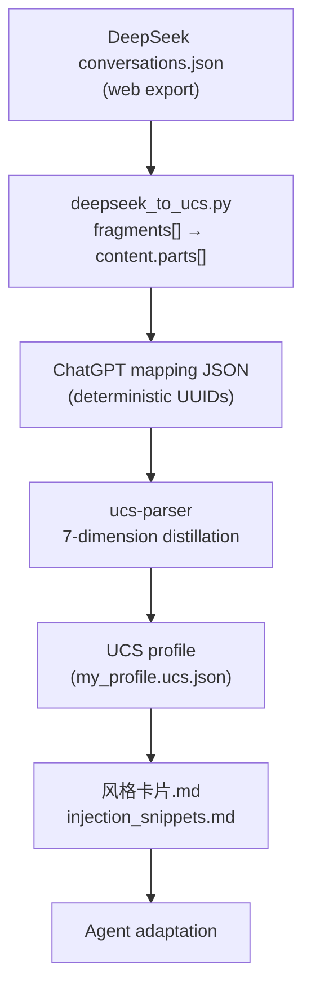

<h1 align="center">deepseek-ucs-adapter</h1>

<p align="center">Convert DeepSeek chat exports into portable UCS user profiles, privacy-first and bilingual.</p>

<p align="center">
  <a href="./README.md">English</a> | <a href="./README.zh-CN.md">简体中文</a>
</p>

<p align="center">
  
  <a href="./LICENSE"></a>
  <a href="https://github.com/SunshineMahiru/deepseek-ucs-adapter/actions/workflows/test.yml"></a>
</p>

## What problem does this solve?

DeepSeek's web export (`conversations.json`) is a `mapping` tree, but message content lives in `message.fragments[]` — eight fragment types observed in practice: `REQUEST`, `RESPONSE`, `THINK`, `TOOL_OPEN`, `TOOL_SEARCH`, `TOOL_FIND`, `SEARCH`, `FILE`.

[ucs-parser](https://github.com/XwhyZ-WHYLD/universal-cognitive-schema), the Universal Cognitive Schema reference implementation, reads only three ChatGPT-format fields: `message.author.role`, `message.content.parts[]`, and `message.create_time`. Feed it a DeepSeek export directly and you get Persona 0.30 and Interaction 0.10 — an almost-empty profile.

This project does two things:

1. **Format conversion** — rewrite DeepSeek `fragments[]` into ChatGPT `content.parts[]` so ucs-parser can extract a real profile. Text-bearing fragments are preserved; tool-only fragments carry no text and are dropped.
2. **Style distillation** — from a linguistic study of 2,856 real user messages, ship a hand-written style card plus three Agent injection templates that turn the profile into concrete Agent behaviour.

## Highlights

| Highlight | Why it matters |
|---|---|
| Fragments → parts conversion | Maps `REQUEST`, `RESPONSE`, `THINK` and `FILE` into `content.parts[]`; tool-only types carry no text and are skipped |
| Deterministic UUID v4 | Re-running the same export produces byte-identical output |
| Privacy-first design | Raw conversation data is excluded from the repository and from the built artefacts |
| Bilingual CLI | `--lang zh|en` switches the tool's own messages and statistics; argparse usage lines stay in English |
| Verifiable research | The 24 unit tests and the two study scripts live in the repository; rerun the scripts on your own export to check the numbers |

## Architecture



The converter itself has no third-party dependency. Only the profile step needs `ucs-parser`.

## Quick Install

Requires Python 3.10+.

```bash
git clone https://github.com/SunshineMahiru/deepseek-ucs-adapter.git
cd deepseek-ucs-adapter

# Install the converter and its `deepseek-ucs` command
pip install .

# Optional: the parser that turns the converted file into a profile
pip install ucs-parser
```

To work on the code instead, use `pip install -e .` and run the tests as shown in [Tests and CI](#tests-and-ci).

## Quick Start

```bash
# 1. Export conversations.json from the DeepSeek web app
#    Settings -> Data management -> Export all conversations, then unzip

# 2. Convert to ChatGPT mapping format
deepseek-ucs conversations.json conversations_chatgpt.json

# 3. Generate the UCS profile
python -c "from ucs_parser import Parser; r = Parser(source='chatgpt').from_file('conversations_chatgpt.json'); r.to_json('my_profile.ucs.json'); print(r.fidelity_report())"
```

The conversion prints per-type fragment counts and writes a `.log` file next to the output. The Fidelity report prints per-dimension scores (Persona, Interaction patterns, and others).

Running from a clone without installing works too: `python deepseek_to_ucs.py conversations.json conversations_chatgpt.json`.

## Usage

`deepseek-ucs` accepts two positional arguments (`input`, `output`) and these flags:

| Flag | Description |
|---|---|
| `--verbose` | Print per-conversation statistics |
| `--dry-run` | Parse and report without writing files |
| `--limit N` | Convert only the first N conversations; N must be a positive integer |
| `--merge-think` / `--no-merge-think` | Keep or drop THINK reasoning fragments (default: keep) |
| `--keep-tool-fragments` | Write SEARCH / TOOL_SEARCH results as `[TOOL] title — url` lines (default: off) |
| `--lang zh\|en` | Switch the tool's own messages and statistics (default: zh) |

Exit codes:

| Code | Meaning |
|---|---|
| `0` | Every conversation was processed, including an empty input array |
| `2` | Unreadable input, not a conversation export, invalid argument, or a failed write |
| `3` | Every conversation was skipped and the output array is empty |

See `examples/sample_profile.json` for a sanitized output sample (domain names replaced with `Domain A–J`, dates fuzzed). The real profile is not committed because it contains personal domains and timestamps.

## Container

The release pipeline builds an OCI image from the released wheel. The `0.1.0` image is not anonymously pullable yet, so build it locally:

```bash
python -m build
docker build -t deepseek-ucs-adapter:local .

docker run --rm --user "$(id -u):$(id -g)" -v "$PWD:/work" \
  deepseek-ucs-adapter:local conversations.json conversations_chatgpt.json
```

The image runs as an unprivileged user. `--user` is only needed on Linux to keep the output file owned by your host account; omit it on Docker Desktop.

## Getting your data

DeepSeek web app → **Settings** → **Data management** → **Export all conversations** → unzip to get `conversations.json`.

The exported file contains your full conversation text; never commit it to a public repository. This repo's `.gitignore` excludes `conversations*.json` by default.

## Tests and CI

```bash
python -m unittest discover -s tests -v
```

24 cases cover a normal round trip, the THINK switch, fragment type normalisation, missing and cyclic parent chains, malformed nodes, attachment counting, timestamp parsing, UUID determinism, and the CLI exit codes. `.github/workflows/test.yml` runs them on Python 3.10, 3.12 and 3.13 for every push and pull request; the release workflow runs the same suite before building.

## Repository layout

| Path | Purpose |
|---|---|
| `deepseek_to_ucs.py` | Converter and `deepseek-ucs` entry point |
| `tests/test_deepseek_to_ucs.py` | Unit tests |
| `examples/sample_profile.json` | Sanitized profile sample |
| `research/analyze_deepseek.py` | Fragment and field survey of an export |
| `research/research_fix_analysis.py` | Correction-marker study behind the style card |
| `调研与方案设计.md` | Field survey, design rationale and measured fidelity |
| `风格卡片.md` | Hand-written interaction rules |
| `injection_snippets.md` | Three Agent injection templates |
| `Dockerfile` | Image built from the released wheel |

The two research scripts take the export paths as arguments and are excluded from the source distribution.

## Research findings

Empirical results over 2,856 user messages from the 2026-10-15 export (667 conversations; details in `调研与方案设计.md`):

- Structure-bound explicit correction markers ("you misunderstood me" and similar): 0–2 occurrences
- Explicit redo ("重新回答"): 6–7 occurrences
- 90% of turn-taking candidates are brand-new requests; 0% are explicit corrections

Conclusion: ucs-parser's `corrections` concept is structurally scarce in a Chinese analytical-collaboration corpus, so further regex tuning has marginal value. This project ships a hand-written style card instead.

## Limitations

- ucs-parser v0.1.0 accepts only ChatGPT format, so conversion is required first
- Interaction patterns has a structural ceiling for Chinese data (measured 0.41), due to scarce explicit correction signals
- `language_preferences` is hardcoded to `"en"` by ucs-parser, with no Chinese detection
- The converter covers the eight observed DeepSeek fragment types; new types will need extension
- Tool-only fragments carry no message body. `SEARCH` and `TOOL_SEARCH` results are dropped by default; `--keep-tool-fragments` keeps their titles and URLs, while `TOOL_OPEN` and `TOOL_FIND` have nothing to keep

## License

[MIT](./LICENSE)

## Acknowledgements

- [ucs-parser](https://github.com/XwhyZ-WHYLD/universal-cognitive-schema) — Universal Cognitive Schema reference implementation
- [ChatInsights](https://github.com/CouriusDeveloper/ChatInsights) — DeepSeek fragments parsing reference
- [ai-conversation-exporter](https://github.com/toke648/chatgpt_to_md) — fragments handling reference
