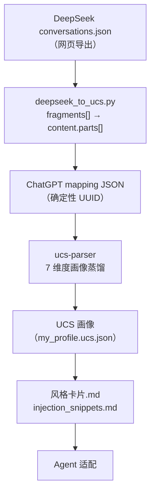

<h1 align="center">deepseek-ucs-adapter</h1>

<p align="center">把 DeepSeek 对话导出转换为可移植的 UCS 用户画像，隐私优先、中英双语。</p>

<p align="center">
  <a href="./README.md">English</a> | <a href="./README.zh-CN.md">简体中文</a>
</p>

<p align="center">
  
  <a href="./LICENSE"></a>
  <a href="https://github.com/SunshineMahiru/deepseek-ucs-adapter/actions/workflows/test.yml"></a>
</p>

## 解决什么问题

DeepSeek 网页版导出的 `conversations.json` 虽然也是 `mapping` 树结构，但消息内容存放在 `message.fragments[]` 中——实测共八种 fragment 类型：`REQUEST`、`RESPONSE`、`THINK`、`TOOL_OPEN`、`TOOL_SEARCH`、`TOOL_FIND`、`SEARCH`、`FILE`。

而 [ucs-parser](https://github.com/XwhyZ-WHYLD/universal-cognitive-schema)（Universal Cognitive Schema 参考实现）只读取 ChatGPT 格式的三个字段：`message.author.role`、`message.content.parts[]`、`message.create_time`。直接把 DeepSeek 导出喂进去，会得到 Persona 0.30、Interaction 0.10 的极低分，画像几乎为空。

本项目做两件事：

1. **格式转换** —— 把 DeepSeek 的 `fragments[]` 改写为 ChatGPT 的 `content.parts[]`，让 ucs-parser 能正确提取画像。带文本的片段保留，纯工具类片段没有文本，会被丢弃。
2. **风格蒸馏** —— 基于 2856 条真实 user 消息的语言学调研，产出手工风格卡片与三种 Agent 注入模板，把画像转成可执行的 Agent 行为。

## 亮点

| 亮点 | 价值 |
|---|---|
| fragments → parts 转换 | 把 `REQUEST`、`RESPONSE`、`THINK`、`FILE` 映射进 `content.parts[]`；纯工具类片段没有文本，直接跳过 |
| 确定性 UUID v4 | 同一份导出重复运行，输出逐字节一致 |
| 隐私优先设计 | 原始对话数据既不进入仓库，也不进入构建产物 |
| 双语 CLI | `--lang zh\|en` 切换工具自身的提示与统计；argparse 的用法行保持英文 |
| 调研可复核 | 24 个单元测试与两个调研脚本都在仓库里，换自己的导出即可重跑 |

## 架构



转换器本身没有第三方依赖，只有生成画像这一步需要 `ucs-parser`。

## 快速安装

需要 Python 3.10+。

```bash
git clone https://github.com/SunshineMahiru/deepseek-ucs-adapter.git
cd deepseek-ucs-adapter

# 安装转换器与 deepseek-ucs 命令
pip install .

# 可选：把转换结果生成画像的解析器
pip install ucs-parser
```

要修改代码，用 `pip install -e .` 安装，测试命令见「测试与 CI」。

## 快速开始

```bash
# 1. 从 DeepSeek 网页版导出 conversations.json
#    系统设置 -> 数据管理 -> 导出所有历史对话，解压得到文件

# 2. 转换为 ChatGPT mapping 格式
deepseek-ucs conversations.json conversations_chatgpt.json

# 3. 生成 UCS 画像
python -c "from ucs_parser import Parser; r = Parser(source='chatgpt').from_file('conversations_chatgpt.json'); r.to_json('my_profile.ucs.json'); print(r.fidelity_report())"
```

转换过程会打印各类 fragment 的计数，并在输出文件旁写一份 `.log`。Fidelity 报告打印各维度分数（Persona、Interaction patterns 等）。

不安装也能从克隆目录直接运行：`python deepseek_to_ucs.py conversations.json conversations_chatgpt.json`。

## 用法

`deepseek-ucs` 接收两个位置参数（`input`、`output`），并支持以下参数：

| 参数 | 说明 |
|---|---|
| `--verbose` | 打印每个会话的转换统计 |
| `--dry-run` | 只解析和统计，不写文件 |
| `--limit N` | 只转换前 N 个会话；N 必须是正整数 |
| `--merge-think` / `--no-merge-think` | 保留或丢弃 THINK 推理片段（默认保留） |
| `--keep-tool-fragments` | 把 SEARCH / TOOL_SEARCH 的搜索结果写成 `[工具] 标题 — 链接` 行（默认关闭） |
| `--lang zh\|en` | 切换工具自身的提示与统计（默认 zh） |

退出码：

| 退出码 | 含义 |
|---|---|
| `0` | 全部会话处理完成，空数组输入也算成功 |
| `2` | 输入无法读取、不是会话导出、参数非法，或写入失败 |
| `3` | 所有会话都被跳过，输出为空数组 |

脱敏输出示例见 `examples/sample_profile.json`（领域名替换为 `Domain A–J`，日期模糊化）。真实画像因含个人领域与时间信息，不入库。

## 容器

发布流程会用发布 wheel 构建 OCI 镜像。`0.1.0` 的镜像目前还不能匿名拉取，请在本地构建：

```bash
python -m build
docker build -t deepseek-ucs-adapter:local .

docker run --rm --user "$(id -u):$(id -g)" -v "$PWD:/work" \
  deepseek-ucs-adapter:local conversations.json conversations_chatgpt.json
```

镜像以非特权用户运行。`--user` 只在 Linux 下用于让输出文件保持宿主账号的属主，Docker Desktop 可以省略。

## 数据获取

DeepSeek 网页版 → **系统设置** → **数据管理** → **导出所有历史对话** → 解压得到 `conversations.json`。

导出的 `conversations.json` 含你的全部对话原文，切勿提交到公开仓库。本项目 `.gitignore` 已默认排除 `conversations*.json`。

## 测试与 CI

```bash
python -m unittest discover -s tests -v
```

24 个用例覆盖正常轮次、THINK 开关、片段类型归一、缺失与环形父链、损坏节点、附件计数、时间戳解析、UUID 确定性与命令行退出码。`.github/workflows/test.yml` 在每次 push 与 PR 上跑 Python 3.10、3.12、3.13；发布流程在构建前也会跑同一套测试。

## 仓库结构

| 路径 | 用途 |
|---|---|
| `deepseek_to_ucs.py` | 转换器与 `deepseek-ucs` 入口 |
| `tests/test_deepseek_to_ucs.py` | 单元测试 |
| `examples/sample_profile.json` | 脱敏画像样例 |
| `research/analyze_deepseek.py` | 导出的片段与字段调研 |
| `research/research_fix_analysis.py` | 风格卡片背后的纠正标记调研 |
| `调研与方案设计.md` | 字段调研、方案设计与实测 fidelity |
| `风格卡片.md` | 手工交互规则 |
| `injection_snippets.md` | 三种 Agent 注入模板 |
| `Dockerfile` | 用发布 wheel 构建的镜像 |

两个调研脚本从命令行接收导出文件路径，不进入源码分发包。

## 调研发现

基于 2026-10-15 导出的 2856 条 user 消息（667 个会话，详见 `调研与方案设计.md`）：

- 结构绑定显式纠正标记（"你理解错了"之类）：0–2 次
- 显式重答（"重新回答"）：6–7 次
- 90% 的"含转折词"候选消息是全新需求，0% 是显式纠正

结论：ucs-parser 的 `corrections` 概念对"中文分析型协作"场景结构性稀缺，继续优化正则边际收益极低，因此改为手工风格卡片。

## 局限性

- ucs-parser v0.1.0 仅支持 ChatGPT 格式，需先经本脚本转换
- Interaction patterns 对中文数据有结构性上限（实测 0.41），因显式纠正信号稀缺
- `language_preferences` 被 ucs-parser 硬编码为 `"en"`，不支持中文检测
- 转换脚本覆盖八种实测 DeepSeek fragment 类型；若 DeepSeek 未来新增类型，需相应扩展
- 纯工具类片段没有正文。`SEARCH` 与 `TOOL_SEARCH` 的结果默认丢弃，加 `--keep-tool-fragments` 可保留标题与链接；`TOOL_OPEN` 与 `TOOL_FIND` 没有可保留的内容

## 许可证

[MIT](./LICENSE)

## 致谢

- [ucs-parser](https://github.com/XwhyZ-WHYLD/universal-cognitive-schema) — Universal Cognitive Schema 参考实现
- [ChatInsights](https://github.com/CouriusDeveloper/ChatInsights) — DeepSeek fragments 解析参考
- [ai-conversation-exporter](https://github.com/toke648/chatgpt_to_md) — fragments 处理参考
